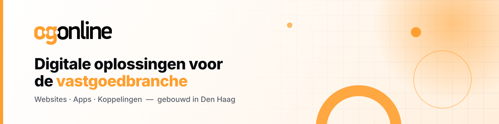

<a href="https://www.ogonline.nl">
  <picture>
    <source media="(prefers-color-scheme: dark)" srcset="./assets/banner-dark.png">
    <source media="(prefers-color-scheme: light)" srcset="./assets/banner-light.png">
    
  </picture>
</a>

## 👋 Hoi, wij zijn OGonline

Wij bouwen **websites, apps en koppelingen voor makelaars** – van de eerste schets tot de laatste deploy. Vanuit Den Haag, voor de hele vastgoedbranche.

### 🛠️ Onze stack

<picture>
  <source media="(prefers-color-scheme: dark)" srcset="https://skillicons.dev/icons?i=svelte,ts,nodejs,php,mongodb,docker&theme=dark">
  
</picture>
&nbsp;

### 🤝 Kom je bij ons werken?

Zin in mooie projecten met een klein, hecht team? We zijn altijd op zoek naar developers.

<b>🍕 Fun fact</b>

 
"OG" staat bij ons voor <b>onroerend goed</b>, niet voor <i>original gangster</i>. 
Al vinden we dat tweede stiekem ook best bij ons passen. 😎

---

